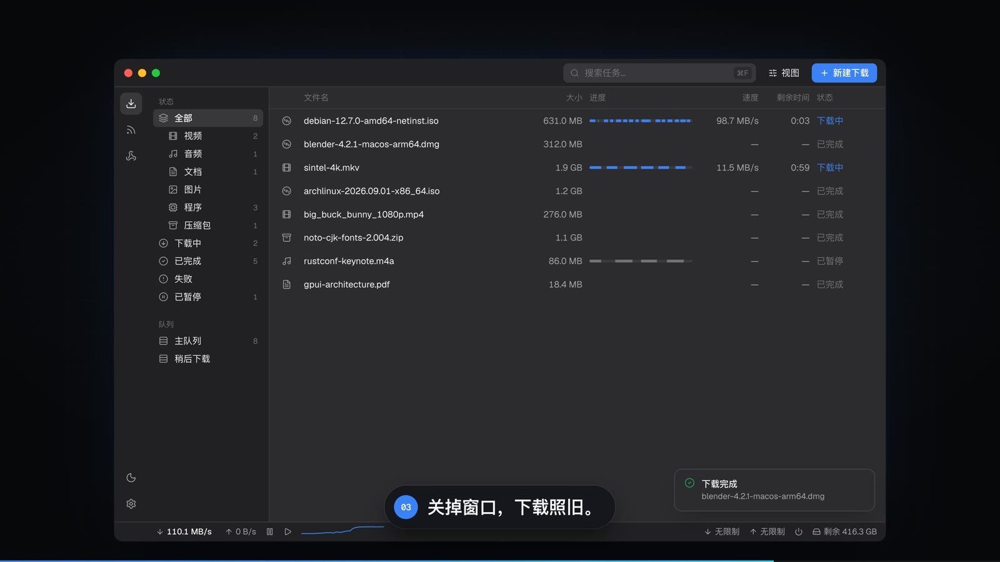

 

 

### 👋 你好，我是 zero

**ZerxLab** 的主理人，一个把「好用」当作信仰的独立开发者。我相信好工具应该 **启动即用、动画顺滑、界面耐看、代码干净** —— ZerxLab 就是我一个人的实验室，专门做这样的东西。

- ⚡ **正在做**：[**FluxDown**](https://github.com/zerx-lab/FluxDown) —— Rust 写的多协议下载管理器，以及它的插件、主题、嗅探规则与分发生态
- 🖥️ **着迷于**：GPUI 原生桌面 · 终端与 AI Agent 工具链 · 本地优先（local-first）软件
- 🧰 **常用**：Rust · Go · TypeScript，需要时也写 Swift / C# / Flutter / Luau
- 💌 **聊聊**：[clown166997982@gmail.com](mailto:clown166997982@gmail.com) · FluxDown 用户群 [832143651](https://fluxdown.com/qq-group)
- 💝 **彩蛋**：偶尔也给媳妇写个[打字练习网站](https://github.com/zerx-lab/ji-key)

<table>
  <tr>
    <td width="33%" valign="top">
      <b>⚡ 快，是一种尊重</b> 
      原生渲染、并行与零拷贝优先；能 1ms 完成的事，不让人等 10ms。
    </td>
    <td width="33%" valign="top">
      <b>🎨 细节即品味</b> 
      一个间距、一帧动画、一句文案，都值得反复打磨。
    </td>
    <td width="33%" valign="top">
      <b>🔓 开放且本地优先</b> 
      开源、无广告、不强制账号；你的数据默认只属于你。
    </td>
  </tr>
</table>

 

## ⚡ FluxDown 主力项目 · Flagship

Rust + Tokio 共享引擎，一套内核驱动 **GPUI 桌面 / Android / iOS / Web UI / CLI**。动态分段 + 慢分段救援，HTTP(S) · FTP · BitTorrent · eD2K · HLS · DASH 全覆盖；浏览器扩展三层拦截接管下载，内置 MCP 服务让 AI 也能帮你管理任务。**免费开源，没有广告，本地下载不需要账号。**

<b>📸 看一眼界面</b>

 

### 🧩 FluxDown 生态

| 仓库 | 角色 | 说明 |
|:--|:--|:--|
| [**fluxdown-plugin-index**](https://github.com/zerx-lab/fluxdown-plugin-index) | 🔌 插件 | 去中心化插件索引：内容寻址 + 多源分发 + 防回滚 |
| [**fluxdown-plugin-github-accel**](https://github.com/zerx-lab/fluxdown-plugin-github-accel) | 🔌 插件 | GitHub 文件下载自动加速，多加速源并行测速优选 |
| [**fluxdown-plugin-accountdl**](https://github.com/zerx-lab/fluxdown-plugin-accountdl) | 🔌 插件 | 借浏览器已登录账号解析网盘分享 / B 站 / Pixiv / 知网直链 |
| [**fluxdown-plugin-musicdl**](https://github.com/zerx-lab/fluxdown-plugin-musicdl) | 🔌 插件 | 全网音乐下载：网易云 / QQ / 酷狗 / 酷我 |
| [**fluxdown-themes**](https://github.com/zerx-lab/fluxdown-themes) | 🎨 主题 | 社区主题市场，提交一个 PR 就能上架 |
| [**fluxdown-sniff-rules**](https://github.com/zerx-lab/fluxdown-sniff-rules) | 🕸️ 规则 | 浏览器扩展的官方与社区嗅探规则 |
| [**fluxdown-sniff-rules-template**](https://github.com/zerx-lab/fluxdown-sniff-rules-template) | 🕸️ 规则 | 维护自己嗅探规则仓库的模板 |
| [**casaos-appstore**](https://github.com/zerx-lab/casaos-appstore) | 📦 分发 | CasaOS / ZimaOS 第三方应用商店 |
| [**unraid-templates**](https://github.com/zerx-lab/unraid-templates) | 📦 分发 | Unraid Community Applications 模板 |
| [**rqbit**](https://github.com/zerx-lab/rqbit) | 🧬 引擎 | Rust BitTorrent 客户端（fork） |
| [sniff-rules-e2e](https://github.com/zerx-lab/sniff-rules-e2e) | 🗄️ 归档 | 嗅探规则端到端测试（已归档） |

 

## 🌟 也在认真做

<table>
  <tr>
    <td width="50%" valign="top">
      <h3><a href="https://github.com/zerx-lab/zap">⌨️ Zap</a></h3>
      开放、本地优先的 AI 终端。基于 Warp 开源版：无强制云端、自带任意 AI 供应商、接入 Claude Code / Codex 等 CLI Agent、内置 SSH 主机管理，中 / 英 / 日 / 俄多语言。
        
      
      
    </td>
    <td width="50%" valign="top">
      <h3><a href="https://github.com/zerx-lab/wordZero">📄 WordZero</a></h3>
      纯 Go 的 Word 文档操作库，遵循最新 OOXML 规范：文档创建与修改、样式体系、表格、模板引擎，零外部依赖。
        
      
      
    </td>
  </tr>
  <tr>
    <td width="50%" valign="top">
      <h3><a href="https://github.com/zerx-lab/rmx">🧹 rmx</a></h3>
      Windows 高性能并行目录删除工具，专治 <code>node_modules</code>、<code>target</code> 这类海量小文件目录，附带 GUI 与统计模式。
        
      
      
    </td>
    <td width="50%" valign="top">
      <h3><a href="https://github.com/zerx-lab/PenBridge">✍️ PenBridge</a></h3>
      写一次，处处发布：一键把文章同步到多个内容平台，配套思源笔记插件与 CLI。
        
      
      
    </td>
  </tr>
</table>

 

## 🧪 实验室全部作品

<b>🤖 AI 与 Agent 工具链</b>

 

| 项目 | 说明 | 技术 |
|:--|:--|:--|
| [**zhive**](https://github.com/zerx-lab/zhive) | 终端 AI 协作 Agent：daemon 式引擎 + JSON-RPC harness，一个引擎、任意客户端 | Rust |
| [**llmsdk**](https://github.com/zerx-lab/llmsdk) | 手感对齐 Vercel `ai-sdk` 的 Rust LLM SDK | Rust |
| [**axon-ai**](https://github.com/zerx-lab/axon-ai) | 跨平台桌面 AI 编程助手，对话式完成编码、编辑与命令执行 | Tauri · React |
| [**axon-doc**](https://github.com/zerx-lab/axon-doc) | AI 驱动的企业级智能知识库 | TypeScript |
| [**LspProxy**](https://github.com/zerx-lab/LspProxy) | LSP 中文翻译代理：hover / 补全 / 诊断里的英文文档实时译成中文 | Go |
| [**repoMcp**](https://github.com/zerx-lab/repoMcp) | 仓库源码检索 MCP：让 IM 机器人里的 LLM 带着可核验出处回答问题 | Go |
| [**omp-dynamic-workflows**](https://github.com/zerx-lab/omp-dynamic-workflows) | 为 omp 打造的脚本化子 Agent 编排：并行、流水线、重试、质量门 | TypeScript |
| [**gpui_ai_profile**](https://github.com/zerx-lab/gpui_ai_profile) | gpui + gpui-component 知识 profile，让 AI 写 GPUI 时不再幻觉 API | Go |
| [**AiFox**](https://github.com/zerx-lab/AiFox) | AI/LLM 流量调试桌面工具：prompt、MCP、tool call 全链路可视化 | Go |
| [**ccproxy_rs**](https://github.com/zerx-lab/ccproxy_rs) | Claude Code 订阅 → 本地 Anthropic / OpenAI 兼容 API 代理 | Rust |
| [**ccproxy**](https://github.com/zerx-lab/ccproxy) | Claude Code 订阅转多种兼容格式 API（TS 版） | TypeScript |
| [**ai-proxy**](https://github.com/zerx-lab/ai-proxy) | 可审计、可观测、带配额分发的 Claude 订阅反向代理网关 | Encore.ts |
| [**localClaudeCodeProxy**](https://github.com/zerx-lab/localClaudeCodeProxy) | Claude Code 本地代理桌面应用 | Go · Wails3 |
| [**zedSlashMcp**](https://github.com/zerx-lab/zedSlashMcp) | 给 Zed 用的斜杠命令 | Go |
| [**aiRules**](https://github.com/zerx-lab/aiRules) | AI 编码助手使用规则集（UIthub API） | Markdown |

<b>🖥️ 桌面与系统工具</b>

 

| 项目 | 说明 | 技术 |
|:--|:--|:--|
| [**zpass**](https://github.com/zerx-lab/zpass) | 零知识密码管理器，端到端加密，处处可用 | TypeScript |
| [**oh-my-clear**](https://github.com/zerx-lab/oh-my-clear) | 键盘优先的跨平台系统清理工具，GPU 渲染界面 + 后台守护进程 | Rust · gpui-kit |
| [**tuck**](https://github.com/zerx-lab/tuck) | macOS 原生菜单栏管理器，把杂乱图标收起来 | Swift |
| [**jianyi**](https://github.com/zerx-lab/jianyi) | 简译：Linux 桌面轻量翻译，全局快捷键 + 划词翻译 | Rust · GPUI |
| [**ZTrans**](https://github.com/zerx-lab/ZTrans) | Linux 弹窗翻译，Google / OpenAI 兼容双后端，流式输出 | Flutter · Rust |
| [**tools**](https://github.com/zerx-lab/tools) | 70+ 离线开发者工具的跨平台桌面工具集 | Go · Wails3 |
| [**ztools**](https://github.com/zerx-lab/ztools) | 个人 Windows 工具箱：修饰键 + 拖拽即可移动 / 缩放任意窗口 | C# · Avalonia |
| [**KeyboardMonitoring**](https://github.com/zerx-lab/KeyboardMonitoring) | 全局键盘事件监听 | C# |

<b>💻 Tern 终端插件</b>

 

| 项目 | 说明 | 技术 |
|:--|:--|:--|
| [**tern-office-preview**](https://github.com/zerx-lab/tern-office-preview) | 在 Tern 终端里原生预览 Word / Excel，Rust 渲染器驱动 | Rust · Luau |
| [**tern-claude-usage**](https://github.com/zerx-lab/tern-claude-usage) | 在 Tern 里实时查看 Claude Pro/Max 用量（5h / 7d / 分模型） | Luau |

<b>📝 文档与写作</b>

 

| 项目 | 说明 | 技术 |
|:--|:--|:--|
| [**wordZero**](https://github.com/zerx-lab/wordZero) | 纯 Go 的 Word 文档操作库 | Go |
| [**PenBridge**](https://github.com/zerx-lab/PenBridge) | 一键发布文章到多个平台 | TypeScript |
| [**PenBridgeSiyuan**](https://github.com/zerx-lab/PenBridgeSiyuan) | 思源笔记插件：一键发布当前文档到腾讯云开发者社区 | TypeScript |
| [**penbridge-cli**](https://github.com/zerx-lab/penbridge-cli) | 可脚本化的思源笔记内核 API 命令行 | Go |
| [**siyuan-share**](https://github.com/zerx-lab/siyuan-share) | 思源笔记分享插件：文档 / 块一键生成公开链接 | TypeScript |
| [**daily-report**](https://github.com/zerx-lab/daily-report) | 基于思源笔记的日报自动化：自动建条目 + Web 管理 + 定时邮件 | Go |

<b>🧱 脚手架与工程化</b>

 

| 项目 | 说明 | 技术 |
|:--|:--|:--|
| [**ZKit**](https://github.com/zerx-lab/ZKit) | 生产可部署、AI 友好的全栈后台脚手架，单二进制上线 | Go · connectRPC · React 19 |
| [**Zera**](https://github.com/zerx-lab/Zera) | 快速开发脚手架 | TypeScript |
| [**relay**](https://github.com/zerx-lab/relay) | Electron + Go 跨平台开发脚手架 | Go · Electron |
| [**actions**](https://github.com/zerx-lab/actions) | 按服务分目录管理的 GitHub Actions 自动化流程 | Shell |
| [**zabbix-deployment**](https://github.com/zerx-lab/zabbix-deployment) | Zabbix 7.0 LTS 离线部署 TUI 向导 | Bun · TypeScript |
| [**LazyVim**](https://github.com/zerx-lab/LazyVim) | 我的 Neovim 配置，基于 LazyVim | Lua |

<b>🌐 站点、小作品与练习场</b>

 

| 项目 | 说明 | 技术 |
|:--|:--|:--|
| [**zerx-lab-website**](https://github.com/zerx-lab/zerx-lab-website) | ZerxLab 官网与博客 [zerx.dev](https://zerx.dev)，全静态双语站点 | Astro |
| [**zerx-lab**](https://github.com/zerx-lab/zerx-lab) | 就是你正在看的这个主页 | Markdown · SVG |
| [**ji-key**](https://github.com/zerx-lab/ji-key) | 给媳妇做的打字练习网站 💝 | TypeScript |
| [**get-topic**](https://github.com/zerx-lab/get-topic) | GetTopic 浏览器扩展 | WXT · React |
| [**zmd5**](https://github.com/zerx-lab/zmd5) | MD5 解密工具 | Go · Fiber |
| [**alterx**](https://github.com/zerx-lab/alterx) | 快速、可定制的子域名字典生成工具 | Go |
| [**demos**](https://github.com/zerx-lab/demos) | Go MVC + 内嵌 SPA 管理后台示例 | Go |
| [**azure-tauri-learn**](https://github.com/zerx-lab/azure-tauri-learn) | 用 GitHub Actions 三端打包 Tauri 应用 | Tauri |
| [**github-copilot-learn**](https://github.com/zerx-lab/github-copilot-learn) | GitHub Actions 学习 demo | HTML |
| [**azure_demo**](https://github.com/zerx-lab/azure_demo) | Azure 相关 Go 示例集合 | Go |
| [**Ori**](https://github.com/zerx-lab/Ori) | 新坑，代码尚未公开 | — |

<b>🍴 Fork 与上游贡献</b> （点击展开）

 

| 方向 | 仓库 |
|:--|:--|
| ⌨️ 终端 / 编辑器 / GUI | [zap](https://github.com/zerx-lab/zap) · [term](https://github.com/zerx-lab/term)（Zed） · [nsh](https://github.com/zerx-lab/nsh) · [gpui-kit-showcases](https://github.com/zerx-lab/gpui-kit-showcases) · [rust-analyzer](https://github.com/zerx-lab/rust-analyzer) · [worktrunk](https://github.com/zerx-lab/worktrunk) · [DeepSeek-TUI](https://github.com/zerx-lab/DeepSeek-TUI) |
| 🤖 AI / Agent | [zcode](https://github.com/zerx-lab/zcode)（omp） · [tau](https://github.com/zerx-lab/tau) · [opencode](https://github.com/zerx-lab/opencode) · [openclaw](https://github.com/zerx-lab/openclaw) · [ai](https://github.com/zerx-lab/ai)（Vercel AI SDK） · [bifrost](https://github.com/zerx-lab/bifrost) · [new-api](https://github.com/zerx-lab/new-api) · [peepie](https://github.com/zerx-lab/peepie) · [agent-browser](https://github.com/zerx-lab/agent-browser) · [everything-claude-code](https://github.com/zerx-lab/everything-claude-code) · [rust-skills](https://github.com/zerx-lab/rust-skills) · [langchaingo](https://github.com/zerx-lab/langchaingo) · [warp-proto-apis](https://github.com/zerx-lab/warp-proto-apis) · [next-ai-draw-io](https://github.com/zerx-lab/next-ai-draw-io) · [AIHOT](https://github.com/zerx-lab/AIHOT) · [firecrawl-docs](https://github.com/zerx-lab/firecrawl-docs) · [awesome-mcp-servers](https://github.com/zerx-lab/awesome-mcp-servers) · [awesome-mcp-servers-1](https://github.com/zerx-lab/awesome-mcp-servers-1) |
| ⬇️ 下载 | [rqbit](https://github.com/zerx-lab/rqbit) · [lux](https://github.com/zerx-lab/lux) |
| 🧱 运行时 / 框架 / 库 | [bun](https://github.com/zerx-lab/bun) · [salvo](https://github.com/zerx-lab/salvo) · [gorm](https://github.com/zerx-lab/gorm) · [lute](https://github.com/zerx-lab/lute) · [convex-js](https://github.com/zerx-lab/convex-js) · [bazaar](https://github.com/zerx-lab/bazaar) |
| 📣 收录与分发渠道 | [awesome-rust](https://github.com/zerx-lab/awesome-rust) · [awesome-alternatives-in-rust](https://github.com/zerx-lab/awesome-alternatives-in-rust) · [awesome-flutter](https://github.com/zerx-lab/awesome-flutter) · [awesome-social-media-downloader](https://github.com/zerx-lab/awesome-social-media-downloader) · [awesome-free-apps](https://github.com/zerx-lab/awesome-free-apps) · [best-chrome-extensions](https://github.com/zerx-lab/best-chrome-extensions) · [awesome-windows](https://github.com/zerx-lab/awesome-windows) · [awesome-windows-1](https://github.com/zerx-lab/awesome-windows-1) · [awesome-windows-2](https://github.com/zerx-lab/awesome-windows-2) · [Awesome-Linux-Software](https://github.com/zerx-lab/Awesome-Linux-Software) · [awesome-macOS](https://github.com/zerx-lab/awesome-macOS) · [awesome-mac](https://github.com/zerx-lab/awesome-mac) · [awesome-homelab](https://github.com/zerx-lab/awesome-homelab) · [awesome-selfhosted-data](https://github.com/zerx-lab/awesome-selfhosted-data) · [open-source-android-apps](https://github.com/zerx-lab/open-source-android-apps) · [android-foss](https://github.com/zerx-lab/android-foss) · [chinese-independent-developer](https://github.com/zerx-lab/chinese-independent-developer) · [portainer-templates](https://github.com/zerx-lab/portainer-templates) · [unRAID-CA-templates](https://github.com/zerx-lab/unRAID-CA-templates) · [Extras](https://github.com/zerx-lab/Extras)（Scoop） |
| 🗂️ 其他 | [ARTEX-EN](https://github.com/zerx-lab/ARTEX-EN) · [real-time-fund](https://github.com/zerx-lab/real-time-fund) |

 

## 🛠️ 工具箱

 

 

